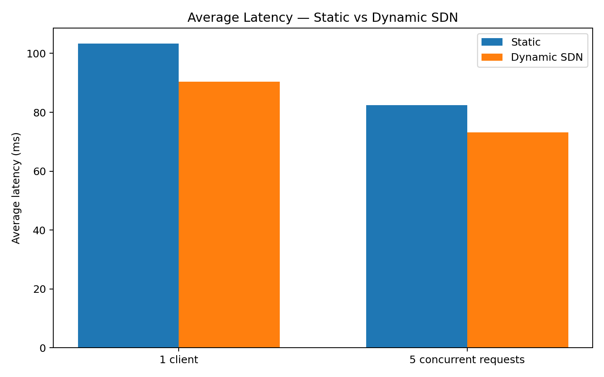
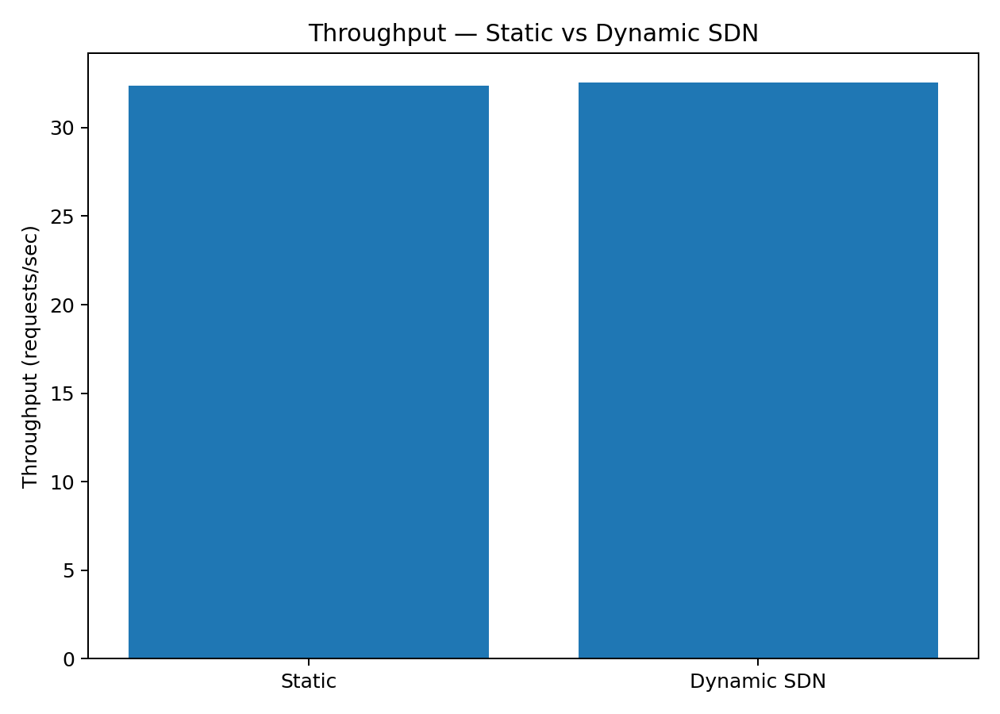

# TCP Proxy + Dynamic SDN Content Filtering

A computer networks project that combines a TCP proxy, content filtering, Mininet, Open vSwitch (OVS), and an OS-Ken SDN controller.

The system allows client requests to pass through a proxy before reaching a simulated destination server. Requests can be allowed or blocked using dynamically installed SDN rules.

## Project Overview

The project demonstrates how traditional proxy-based filtering can be combined with Software-Defined Networking (SDN).
### Architecture

The system consists of Mininet hosts connected through an Open vSwitch network. Client requests are sent to the TCP proxy, which checks the requested site against the current filtering policy. Allowed requests are forwarded to the simulated server, while blocked requests are rejected. SDN rules can be updated at runtime through the SDN controller and rule-management component.

### Main flow

```text
Client 1 ──┐
           │
Client 2 ──┼──> OVS / Mininet ──> TCP Proxy ──> Server
           │              ↑
           └──────────────┤
                          │
                    OS-Ken Controller
                          │
                    Dynamic SDN Rules
```

## Features

- TCP client-server communication
- TCP proxy with content filtering
- Mininet-based network topology
- Open vSwitch (OVS)
- OS-Ken SDN controller
- Dynamic allow/block rules
- Runtime policy changes
- Proxy request logging
- Multiple concurrent request testing
- Performance measurement
- Static vs Dynamic SDN comparison

## Technologies Used

- Python 3
- TCP/IP sockets
- Mininet
- Open vSwitch (OVS)
- OS-Ken
- Linux / Ubuntu
- Bash

## Project Files

| File | Description |
|---|---|
| `client.py` | TCP client used to send requests |
| `server.py` | Simulated destination server |
| `proxy.py` | TCP proxy and content-filtering component |
| `topology.py` | Mininet network topology |
| `controller.py` | Controller-related functionality |
| `sdn_controller.py` | SDN controller component |
| `sdn_rules.py` | Dynamic SDN rule installation |
| `sdn_rules.json` | Stored SDN policy rules |
| `proxy_log.txt` | Proxy request log |
| `.gitignore` | Files excluded from Git |

## Dynamic SDN Rule Demonstration

The project supports changing filtering policies while the system is running.

For example:

```bash
python3 -c "from sdn_rules import install_rule; install_rule('netflix','BLOCK')"
```

The system reports:

```text
SDN Rule Installed: BLOCK -> netflix
```

A subsequent request for `netflix` is then rejected by the proxy:

```text
Proxy replied: Request blocked by proxy!
```

The rule can also be changed back to `ALLOW` at runtime.

This demonstrates runtime policy adaptation without changing the client application.

## Logging

The proxy records request information, including:

- Timestamp
- Client IP and port
- Requested site/message
- Allow/block decision

Example:

```text
2026-10-04 11:07:45 - 10.0.0.1:39954 - youtube - ALLOWED
2026-10-04 10:53:15 - 10.0.0.1:52308 - google - BLOCKED
2026-10-04 11:08:22 - 10.0.0.2:36508 - facebook - ALLOWED
```
## Performance Evaluation

Performance was measured using the TCP client and the Linux `time` command.

### Average Latency

#### 1 Client

Five measurements were collected for each configuration.

| Run | Static | Dynamic SDN |
|---|---:|---:|
| 1 | 150 ms | 89 ms |
| 2 | 74 ms | 77 ms |
| 3 | 76 ms | 164 ms |
| 4 | 129 ms | 71 ms |
| 5 | 88 ms | 51 ms |
| **Average** | **103.4 ms** | **90.4 ms** |

#### 5 Concurrent Requests

Five concurrent request processes were used to evaluate concurrent request handling.

| Run | Static | Dynamic SDN |
|---|---:|---:|
| 1 | 78 ms | 63 ms |
| 2 | 73 ms | 75 ms |
| 3 | 79 ms | 69 ms |
| 4 | 80 ms | 79 ms |
| 5 | 102 ms | 80 ms |
| **Average** | **82.4 ms** | **73.2 ms** |

### Throughput

Ten sequential requests were sent through the proxy and the total execution time was measured.

| Metric | Static | Dynamic SDN |
|---|---:|---:|
| 10-request execution time | 0.309 s | 0.307 s |
| **Throughput** | **32.36 req/s** | **32.57 req/s** |

Throughput was calculated as:

```text
Throughput = Number of requests / Total execution time
```

### Static vs Dynamic SDN Comparison

| Test | Static | Dynamic SDN |
|---|---:|---:|
| Average latency — 1 client | **103.4 ms** | **90.4 ms** |
| Average latency — 5 concurrent requests | **82.4 ms** | **73.2 ms** |
| Throughput | **32.36 req/s** | **32.57 req/s** |

The measured results show lower average latency for the Dynamic SDN configuration in both latency tests. Throughput was very similar between the two configurations, with Dynamic SDN showing a slightly higher measured value in this test.

These results are specific to the test environment and workload used in this project.


## Performance Graphs

### Average Latency — Static vs Dynamic SDN



### Throughput — Static vs Dynamic SDN



## How to Run

### 1. Start the SDN environment

Activate the project environment if required:

```bash
source ~/cn_proxy_project/sdn-env/bin/activate
```

### 2. Start the Mininet topology

Run the project's topology:

```bash
sudo python3 topology.py
```

### 3. Start the proxy

From the Mininet CLI:

```text
proxy python3 /home/sreelekha/cn_proxy_project/proxy.py &
```

The proxy listens on:

```text
0.0.0.0:8000
```

### 4. Start the destination server

From the Mininet CLI:

```text
server python3 /home/sreelekha/cn_proxy_project/server.py &
```

The simulated server listens on:

```text
0.0.0.0:9000
```

### 5. Send a request

From a Mininet client:

```text
client1 python3 /home/sreelekha/cn_proxy_project/client.py
```

Enter a request such as:

```text
youtube
```

The proxy forwards allowed requests to the simulated server.

## Example

### Allowed request

```text
Enter request: youtube
Proxy replied: Hello from Server! Request 'youtube' was processed.
```

### Blocked request

After installing a blocking rule:

```text
SDN Rule Installed: BLOCK -> netflix
```

A request produces:

```text
Enter request: netflix
Proxy replied: Request blocked by proxy!
```

## Project Outcome

The project demonstrates:

1. TCP communication between clients and a server.
2. Proxy-based request filtering.
3. SDN-controlled network policy.
4. Runtime installation of filtering rules.
5. Logging of network requests.
6. Concurrent request handling.
7. Performance comparison between static and dynamic policy configurations.

## Project Status

- Core TCP proxy and client-server communication — Complete
- Mininet and OVS topology — Complete
- OS-Ken SDN controller — Complete
- Dynamic filtering rules — Complete
- Runtime policy changes — Complete
- Request logging — Complete
- Concurrent request testing — Complete
- Performance evaluation — Complete
- Static vs Dynamic SDN comparison — Complete

## Future Scope

- Support for a larger number of Mininet hosts
- More advanced traffic classification
- Automated policy generation
- Web-based monitoring dashboard
- More extensive performance benchmarking
- Additional traffic-control policies

## Disclaimer

This project uses a simulated destination server and a controlled Mininet environment for educational and experimental purposes.
